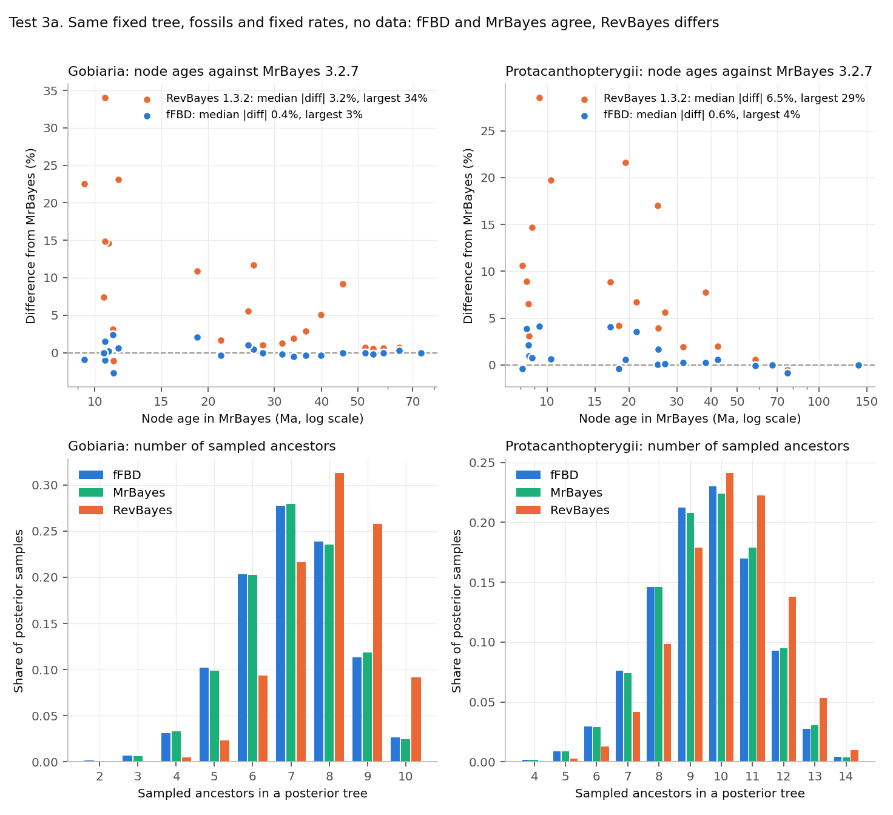
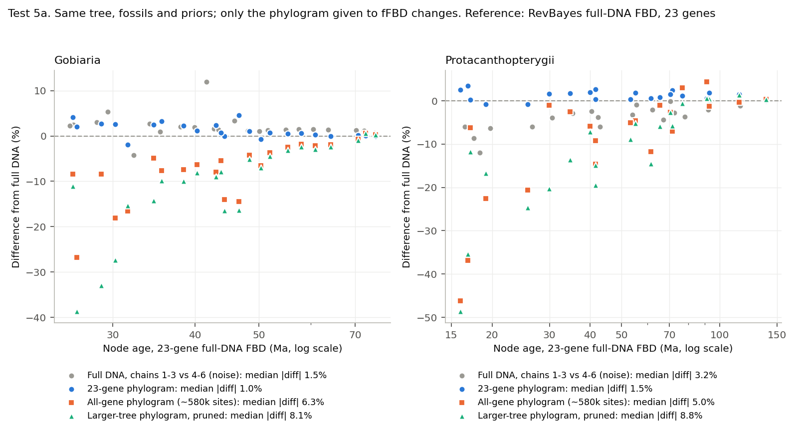

# Validation of fFBD: details

This file holds the numbers behind the [README Validation section](README.md#validation), which gives the plain-language questions, approach and references. Tests are numbered the same way in both. "RevBayes" means RevBayes 1.3.2 and "MrBayes" means MrBayes 3.2.7. Result files and figures are in `validation/`; the scripts are in `scripts/`.

**Data labels.** fFBD never reads DNA. Its data are a phylogram: branch lengths of the fixed living-species tree, in substitutions per site, with standard errors.

- **No data**: fossils and priors only.
- **Phylogram**: branch lengths and standard errors, estimated from DNA or simulated.
- **DNA**: the full alignment, analyzed by RevBayes or MrBayes as the reference, while fFBD gets a phylogram estimated from the same DNA.

**Data sets.**

- **A06**: Gobiaria, 24 living species and 10 fossils.
- **A12**: Protacanthopterygii, 22 living species and 14 fossils.
- A06 and A12 each have a 23-gene alignment of 16,107 sites.
- **Bears**: the RevBayes tutorial data.
- **Catfishes**: 713 living species and 94 fossils.
- **Simulated** data sets, described under each test.

## Summary

| Question | # | Test | Data | Result |
|---|---|---|---|---|
| 1. Right probabilities | 1 | Every probability term against RevBayes, on fixed trees | No data and phylogram | Passed: difference at most 4e-9 |
| | 1c | Estimated shift times: exact numerical integration; fixed shifts against RevBayes | No data | Passed: marginal likelihood within 0.01 of exact |
| 2. Finds the known truth | 2a | Simulation-based calibration, small trees | No data and simulated phylogram | Passed |
| | 2b | Simulation-based calibration, 2 to 8,056 living species | Simulated phylogram | Passed |
| | 2c | Exact 3-species prior | No data | Passed |
| | 2d | Estimated shift times: simulation-based calibration; number of shifts by marginal likelihood | No data and simulated phylogram | Passed; 0 or 1 shift recovered on 29 and 27 of 30 trees |
| | 2e | Heated chains (Metropolis-coupled MCMC): simulation-based calibration; heated against plain chains | Simulated phylogram | Passed on a larger repeat; no difference from plain chains |
| 3. Independent program agrees | 3a | fFBD, MrBayes and RevBayes on the same fixed-rate prior | No data | fFBD = MrBayes; RevBayes differs |
| | 3b | fFBD and RevBayes with one RevBayes move off | No data | Agree |
| 4. Shortcut = DNA | 4a | fFBD against RevBayes full-DNA FBD | DNA vs phylogram | Agree, within DNA chain noise |
| | 4b | Simulation study, 100 trees of 30 to 120 tips | Phylogram from simulated DNA | Near 95% coverage |
| | 4c | Catfishes against an earlier full-DNA analysis | DNA vs phylogram | Close, not like for like |
| 5. What matters more | 5a | Which phylogram: 23 genes, all genes, larger tree | DNA vs phylograms | 23-gene phylogram = 23-gene DNA; more genes give younger ages |
| | 5b | fFBD against MrBayes full-DNA FBD (IGR clock) | DNA vs phylogram | Gobiaria agrees; Protacanthopterygii is clock-sensitive |
| | 5c | Clock models by marginal likelihood, on DNA (RevBayes) and on the phylogram (`ffbd --ss`) | DNA; phylogram | Gamma and lognormal best or near best; exponential 9 to 147 log units worse |
| | 5d | Sampling fraction (rho) | Phylogram | Up to 8% younger at rho 50% |
| | 5e | Few against many genes, known true ages | Phylograms from simulated DNA | 1,000 genes more accurate than 23 (63% of nodes closer) |
| | 5f | Partitioned branch lengths, known true ages | Phylograms from simulated DNA | One model makes young nodes too old; gene x codon (or ModelFinder) partitions remove most of it |
| 6. Large trees | 6a | Convergence at 1,185 and 2,424 tips | Phylogram | Passed |
| | 6b | Crown, stem and daughter-stem rules | Phylogram | Passed |
| | 6d | Automatic starting tree | Phylogram | Passed: valid on 1,184 species; same answer as a supplied start |
| | 6e | Clades of fossils only (`regraft_clade`) | No data and simulated phylogram | Passed: simulation-based calibration in 3 settings; the clade moves between branches; same answer from different starts |
| | 6c | Speed | Phylogram | No slowdown with size |

## 1. Right probabilities

### Test 1. Probabilities on fixed trees (passed)

*Data: no data and phylogram.* For fixed trees and parameter values, every term was compared with RevBayes: FBD density, root prior, rate priors, data terms and fossil windows (`scripts/density_check.py`).

| Data set | States compared | Largest difference in the total |
|---|---|---|
| A06 | 24 | 3.7e-10 |
| A12 | 24 | 2.8e-9 |
| Bears | 17 of 18 | 2.0e-9 |
| Catfish | 24 | 3.7e-9 |

RevBayes refused to build one bear state, because its origin was below a fossil's window maximum. That is a check at model construction, not a difference in density.

### Test 1b. Rate shifts, skyline FBD (passed)

*Data: no data and phylogram.* With `rate_shifts`, lambda, mu and psi are piecewise-constant between fixed times (README, The skyline model). Results: `validation/skyline_checks.txt`; scripts `sky_density_check.py`, `sbc_sky.py`.

| Check | Result |
|---|---|
| No shifts: same output as the constant-rate model | 18 of 18 `.log`/`.trees` files byte-identical (examples and bears, six option sets, 3 million proposals); `make test` passes |
| FBD density against RevBayes 1.3.2 `dnBDSTP(timeline=...)` | 1,012 states, 1 to 3 shifts, both conditionings, 4 to 2,772 tips: largest difference 7.8e-12 up to 152 tips, 2e-9 on the 1,184-species tree |
| Equal rates in every interval | equals the constant-rate density |
| Cache check (`--check-every-step`) | no error in 135 runs on the examples and 11 on the 1,184-species tree, all five clocks |
| Prior recovery | with the FBD density switched off, every interval's rates recover Exp(10) (KS tests, smallest p 0.021 of 26) |
| Simulation-based calibration, 2 shifts | ranks uniform in 4 settings, 1,600 replicates (smallest p 0.0045, Bonferroni threshold 0.0029) |
| Speed, 1,184 species | 0.18 s per million proposals without shifts; 0.30 with 2 shifts, 0.33 with 3 |

Differences from RevBayes that remain, and why:
- RevBayes adds a constant from an approximation of ln N! (-4.7e-8 at 7 tips); it was removed before comparing.
- In 28 states of the 1,184-species tree where a node or fossil age equals a shift time exactly, RevBayes differs by up to 5.2e-5; an independent 50-digit evaluation agrees with fFBD there.
- One degenerate state (a fossil branch of zero length that is not a sampled ancestor) differs by 0.58; the constant-rate code can reach it only by rounding.

### Test 1c. Estimated shift times and the FBD-power stepping-stone (passed)

*Data: no data.* With `--rate-shifts free:K` or `lo:hi` windows the shift times are parameters (README, The skyline model); `--ss-power fbd` puts the stepping-stone powers on the FBD density to compare rate models. Results: `validation/skyline_estimated_checks.txt`; scripts `est_grid_check.py`, `est_rb_check.py`.

| Check | Result |
|---|---|
| No new option: same output as the previous release | 24 run settings (3 examples; default, burn-in, no data, gam, acln, control, fixed shifts) byte-identical, plus checkpoint and stepping-stone files; 120 `ffbd_sim` runs identical |
| Cache check (`--check-every-step`) | no error in 60 runs: 3 examples, 5 clocks, `free:1`, `free:2`, windows, windows with a fixed time |
| Restart from a checkpoint | byte-identical to an uninterrupted run |
| Prior recovery | with the FBD density switched off, shift times follow their prior (order statistics of uniforms; KS p 0.07 to 0.74) and rates Exp(10) |
| Exact integration, one time | bears tree and rates fixed, one time in a 3-10 Ma window: posterior against a 1,400-cell grid, KS p 0.74; marginal likelihood -186.577 and -186.572 against exact -186.576 |
| Exact integration, two free times | `free:2` on [0, 33.9]: marginal likelihood -188.950 and -188.942 against -188.944 on a 0.01 Myr grid (5.7 million cells); posterior against the grid, KS p 0.37 (first time) and 0.06 (second) |
| New moves `shift_data`, `shift_relocate` | cache check in 105 runs; prior recovered by each move alone (KS p 0.17 to 0.95); one time: KS p 0.43, marginal likelihood within 0.004 of exact; two times: within 0.01, posterior against the grid KS p 0.32 and 0.25 (20,000 samples); runs without estimated shifts byte-identical to the previous release |
| Fixed shifts against RevBayes | bears tree fixed, rates free: posterior means of all 9 rates agree (within 1.9 Monte Carlo standard errors); marginal likelihood -201.050 / -201.035 against RevBayes -201.048 / -201.092 |

Notes:
- The FBD density jumps where a shift time crosses a node or fossil age, because the event then falls in the other interval, so the grid has to be fine: on a 0.1 Myr grid the two-time posterior seemed off (KS p < 0.001); on the 0.01 Myr grid it agrees. The grid is computed with the test option `--eval-shifts FILE`, which prints the FBD density of the start tree and rates for each line of shift times.
- The grid KS test interpolates the grid CDF inside each 0.01 Myr cell. An earlier version of the script gave each sample the CDF at the top of its cell, which made the first time look slightly off (KS p 0.015 to 0.033) for the old and new moves alike.
- RevBayes 1.3.2 cannot check estimated shift times. With a stochastic timeline (`t ~ dnUniform(...)`, `timeline := v(t, ...)`), dnBDSTP gives the right value after `setValue`, but during MCMC it is not recomputed when the time moves: the likelihood stays at its start value in every sample, so the time samples its prior (KS p 8e-112 against the exact posterior). Exact integration replaces RevBayes for these checks.

## 2. Finds the known truth

### 2a. Simulation-based calibration, small trees (passed)

*Data: no data, and simulated phylograms.* Data sets were simulated exactly from the model with known true values, using `ffbd_sim` (separate code from the sampler; `scripts/sbc.py`). If the sampler is correct, the rank of each true value among the posterior samples is uniform. There were 500 replicates per setting. 13 parameters were tested by chi-square and Kolmogorov-Smirnov tests, with a Bonferroni threshold of 0.0038.

| Setting | Smallest p-value | Result |
|---|---|---|
| Root-conditioned, with data | 0.014 | Passed |
| Root-conditioned, no data | 0.079 | Passed |
| Origin-conditioned, with data | 0.014 | Passed |

Testing found and fixed two bugs: a cached sum of rates that could become corrupted, and a checkpoint restart that was not exactly reproducible. All tests were rerun after the fixes, and a restarted run now gives byte-identical output.

### 2b. Simulation-based calibration at realistic size (passed)

*Data: simulated phylograms.* Run with `scripts/sim_study.py sbc`.

- **Priors and truth.** Each of 500 replicates draws speciation, extinction, fossil sampling and the mean clock rate from the fFBD priors (exponential, rate 10), and the root from the analysis prior Normal(30, 2).
- **Simulation.** It then simulates an FBD tree with no size filter. Only information that is exact for this test is used: fossil windows on a fixed 4-Myr grid, one constraint per side of the root, and a constant observation standard deviation (0.01).
- **Tree sizes.** 2 to 8,056 living tips (median 20) and 0 to 15,838 fossils (median 25).
- **Scoring.** Each replicate ran 100 million proposals, thinned to 99 draws. The rank of the true value among them was scored with `scripts/sbc_ranks.py` (`validation/sbc_realistic_500reps.txt`).
- **Threshold.** Bonferroni for 9 tests: p < 0.0056.

| Quantity | n | Uniformity p (20 bins) | Mean rank (0.5 expected) | Median ESS |
|---|---|---|---|---|
| Speciation | 500 | 0.66 | 0.490 | 361 |
| Extinction | 500 | 0.50 | 0.503 | 361 |
| Fossil sampling | 500 | 0.65 | 0.488 | 361 |
| Mean clock rate | 500 | 0.087 | 0.485 | 320 |
| Root age | 500 | 0.79 | 0.493 | 361 |
| Number of sampled ancestors | 500 | 0.91 | 0.504 | 361 |
| Crown age, root side 1 | 407 | 0.24 | 0.522 | 172 |
| Crown age, root side 2 | 407 | 0.17 | 0.513 | 180 |
| One random fossil's age | 482 | 0.87 | 0.494 | 361 |

Each panel is a histogram of the rank of the true value (0 to 99) over the 500 replicates. A correct sampler gives flat bars. The dashed line is the expected height, and the dotted lines are the 99% range for chance. Low ends would mean intervals too narrow, a central hump intervals too wide, and a slope bias. All nine panels are flat.

### 2c. Exact 3-species prior (passed)

*Data: no data.* An exact analytic check of a 3-species, 1-fossil prior agreed (`scripts/analytic_check.py`; `validation/analytic_check.txt`):

| Quantity | MCMC | Exact |
|---|---|---|
| Sampled-ancestor probability | 0.6871 | 0.6889 |
| Mean fossil age | 4.913 | 4.914 |

### 2d. Estimated shift times (passed)

*Data: no data and simulated phylograms.*

**Simulation-based calibration.** `ffbd_sim` draws the shift times from their prior inside its rejection loop, jointly with the rates (`sbc_sky.py --shifts free:K:lo:hi` or windows). 1,000 replicates per setting, 17 to 21 quantities including the shift times, chi-square and KS tests; Bonferroni threshold 0.05 divided by the number of quantities (0.0024 to 0.0029).

| Setting | Smallest p-value | Shift times | Result |
|---|---|---|---|
| `free:1` on [2, 16] | 0.011 | uniform | Passed |
| `free:2` on [2, 16] | 0.0022 (a node age; KS 0.029); repeated with new seeds: 0.041 | p 0.07 to 0.94 | Passed on repeat |
| Windows 3-8 and 10-15 Ma | 0.0088 | uniform | Passed |
| `free:2`, origin conditioning | 0.012 | uniform | Passed |
| `free:2`, only lambda and mu vary | 0.064 | uniform | Passed |
| `free:2`, no data | 0.013 | uniform | Passed |

**Recovery of the number of shifts.** `sim_study.py simulate --shifts` simulated 90 trees forward (31 to 119 living species, 11 to 60 fossils, phylogram from the model), 30 per scenario. Each tree was fitted with no shift, `free:1` and `free:2`, two stepping-stone replicates each (`--ss 100 --ss-power fbd --ss-gens 2000000`).

| True model | Picked | Notes |
|---|---|---|
| No shift (lambda 0.10, mu 0.06, psi 0.01) | none 29, one 1 | the one miss by 0.3 log units |
| One shift at 50 Ma (fossil sampling 0.03 before, 0.006 after) | one 27, two 2, none 1 | median log Bayes factor one vs none +6.1; true time inside the 95% interval on 26 of 30 |
| Two shifts at 30 and 70 Ma | one 18, none 11, two 1 | two shifts are rarely detected on trees this small |

Replicate stepping-stone estimates differed by a median of 0.45 log units (largest 3.3).

**With the new shift-time moves** (`shift_data`, `shift_relocate`; README, The skyline model) all six SBC settings were rerun with 1,000 new replicates each: smallest p-values 0.010 to 0.069 (chi-square or KS), shift times p 0.015 to 0.98; all passed. The recovery study was rerun on 90 new trees: no shift picked on 30 of 30, one shift on 27 of 30 (two on 3) with the true time inside the 95% interval on 26 of 30, and for two true shifts one 15, none 11, two 4. Details: `validation/shift_moves_heated_checks.txt`. The four misses of the shift time all fell on the older side (lower bounds 51 to 55 Ma); this study simulates with fixed parameters and a tree-size filter, so unlike SBC it does not have to give exactly 95%.

### 2e. Heated chains (passed on a larger repeat)

*Data: simulated phylograms.* `--heated K` runs K copies with the FBD density (or FBD and phylogram) raised to powers between 1 and `--hottest`, and logs the cold copy (README, Heated chains). Results: `validation/shift_moves_heated_checks.txt`.

**Code checks.** Cache check of every copy after every proposal: 72 runs (4 examples, 3 clocks, no shift / `free:2` / fixed shifts, heat on FBD or on FBD and data), no error. Output with 1 and 4 threads byte-identical; checkpoint and resume byte-identical. Exact integration, one shift time: KS p 0.17, marginal likelihood -186.579 to -186.572 against exact -186.576.

**Simulation-based calibration.** 3 copies, `--swap-every 100`, 1,000 replicates per run. Every run is listed:

| Run | Burn-in | Replicates | Smallest p (chi-square, KS) | Result |
|---|---|---|---|---|
| `free:2`, heat on FBD | 100k | 1,000 | 0.011, 0.13 | Passed |
| `free:2`, heat on FBD and data | 100k | 1,000 | 0.022, 0.059 | Passed |
| Windows 3-8 and 10-15 Ma, heat on FBD | 100k | 1,000 | 0.0019 (first shift time), 0.005 | Failed |
| Fixed shifts 6 and 12, heat on FBD and data, hottest 0.2 | 100k | 1,000 | 0.034, 0.027 | Passed |
| Windows, heat on FBD, new seeds | 100k | 755 (stopped) | 0.062, 0.0011 (a node age) | Failed |
| `free:2`, heat on FBD, new seeds | 2M | 1,000 | 0.0004 (sampled ancestors), 0.018 | Failed |
| Windows, heat on FBD, new seeds | 2M | 468 (stopped) | 0.0022 (sampled ancestors), 0.014 | Failed |
| Windows, heat on FBD, hottest 0.9 | 2M | 1,000 | 0.15, 0.024 | Passed |
| Windows, heat on FBD, new seeds | 10M | 1,000 | 0.022, 0.11 | Passed |
| **Repeat**, `free:2`, heat on FBD, new seeds | 100k | 2,000 | 0.0067, 0.010 | Passed |
| **Repeat**, windows, heat on FBD, new seeds | 100k | 2,000 | 0.019, 0.010 | Passed |

Four of the first nine runs had one quantity below the Bonferroni threshold (0.0024), more than the about 1 in 10 expected by chance, all with the heat on the FBD density only. The failing quantity changed from run to run, and a longer burn-in did not remove it. The code was checked again (every acceptance ratio uses the same power as the swap step), and two tests with more power were run. A repeat with new seeds and 2,000 replicates in each of the two settings with failures, decided before seeing any result, passed. The direct comparison below found no difference. The earlier failures are most likely chance, made more frequent by rerunning the settings that had failed. Heated chains have still been checked less than the plain sampler.

**Heated against plain chains.** One data set (`examples/example_input.txt`, gamma clock), 20 plain and 20 heated runs (3 copies, heat on FBD, powers 1, 0.55, 0.3), 40 million proposals each, different seeds. Welch t-test of the run means for 24 quantities: smallest p 0.23 with two shift windows, 0.12 with `free:2`. No quantity differs. Earlier, on the bears data, 4 seeds of 30 million: largest difference 1.9 standard errors over 32 quantities.

## 3. Independent program agrees

### 3a. fFBD, MrBayes and RevBayes on the same prior (fFBD = MrBayes)

*Data: no data.* `scripts/make_fixed3.py` writes the same model for all three programs:

- the A06 or A12 living-species tree, fixed (in MrBayes, one partial constraint per living-species node, with fossils free);
- the same clade constraints;
- uniform fossil age windows (MrBayes `calibrate`);
- speciation 0.10, extinction 0.04, fossil sampling 0.03 and the root age, all **fixed**.

With every rate fixed, the three programs must give the same node ages and the same number of sampled ancestors. There were two chains per program and data set, compared with `scripts/compare_fixed3.py` (`validation/three_program_prior_A06_A12.txt`).

| Data set | Mean sampled ancestors, fFBD / MrBayes / RevBayes | Node ages, fFBD vs MrBayes (median, largest) | RevBayes vs MrBayes (median, largest) | MrBayes chain 1 vs chain 2 (median, largest) |
|---|---|---|---|---|
| A06 | 7.01 / 7.02 / 7.95 | 0.36%, 2.7% | 3.2%, 34% | 0.89%, 7.4% |
| A12 | 9.55 / 9.58 / 10.13 | 0.59%, 4.2% | 6.5%, 28.5% | 0.86%, 6.4% |

fFBD and MrBayes agree within chain noise. RevBayes gives about one extra sampled ancestor and older young nodes. The difference is largest on two-tip nodes: for example, 10.6 Ma in MrBayes and 14.2 Ma in RevBayes.

The same pattern appears when RevBayes and fFBD are compared directly, with estimated rates (`validation/compare_pilots_summary.txt`):

| Data set | Data | Median difference in node ages | Largest difference |
|---|---|---|---|
| A06 | No data | 1.64% | 12.8% |
| A12 | No data | 4.97% | 8.1% |
| A06 | Phylogram | 1.13% | 21.5% |
| A12 | Phylogram | 2.59% | 13.0% |
| Bears | Phylogram | 8.96% | 12.6% |

RevBayes node-age ESS was low on these runs (32 to 35 per chain on the phylogram runs), so part of each difference is RevBayes sampling noise.

**Explanation.** The cause is the RevBayes move `mvCollapseExpandFossilBranch` (`CollapseExpandFossilBranchProposal.cpp`, v1.3.2):

- When the move adds a sampled ancestor's branch, it draws the new age from above the maximum of the fossil's age window.
- The reverse move can start from attachments inside the window, and the forward move cannot reach those.
- So the move is not reversible for fossils with age ranges.

Four results support this:

1. The probabilities are identical (test 1).
2. The two programs agree once the move is removed (test 3b).
3. fFBD recovers the truth in simulation (tests 2a to 2c).
4. MrBayes, written independently, agrees with fFBD (this test).

This has not yet been confirmed with the RevBayes developers. `ffbd --rb-sa-move` imitates that proposal, for testing only.

**BEAST2.** The sampled-ancestor package of BEAST2 (Gavryushkina et al. 2014) was not used. Its clade constraints count fossils as clade members, so it cannot hold the living-species tree fixed while fossils move within their clades.

### 3b. fFBD and RevBayes with the collapse-expand move off (passed)

*Data: no data.* `scripts/compare_runs.py`; `validation/E1_noCE_summary.txt`.

| Data set | Node-age medians, median difference | Largest difference | Two RevBayes chains differ by (median) |
|---|---|---|---|
| A06 | 0.28% | 1.44% | 0.59% |
| A12 | 0.41% | 1.44% | 0.70% |

## 4. Shortcut = DNA

### 4a. fFBD against RevBayes full-DNA FBD (agree)

*Data: DNA (RevBayes) against a phylogram from the same DNA (fFBD).*

- **Model.** RevBayes full-DNA FBD and fFBD were run on A06 and A12 with GTR+G, an exponential clock, the fixed living-species tree, and the 23 genes (16,107 sites).
- **Shared settings.** Both used the same fossils, constraints, priors and uniform root prior.
- **One difference.** The RevBayes collapse-expand move was removed (test 3), so the only remaining difference is the branch-length shortcut.
- **Summary.** Each side was summarized as an extant time tree (median node ages), and nodes were matched by clade (`scripts/branch_scatter.py --ages-only`; `validation/node_ages_full_vs_fast.tsv`).

| Data set | Nodes | r | Median difference | Mean difference (Fast minus full) | Root age, full vs Fast | DNA chains 1-3 vs 4-6 (median) |
|---|---|---|---|---|---|---|
| A06 | 23 | 0.9995 | 1.3% | +0.5 Myr | 75.2 vs 75.2 Ma | 1.5% |
| A12 | 21 | 0.9997 | 1.8% | +0.7 Myr | 139.0 vs 139.0 Ma | 3.2% |

| Side | Chains | Length per chain | Run time per chain |
|---|---|---|---|
| Full DNA, RevBayes | 6 | 250,000 generations | ~22 to 25 h |
| Phylogram, fFBD | 2 | 400 million proposals | ~2.5 min |

Full-DNA node-age ESS per chain is low (median 19 for A06 and 35 for A12 on the first chains), which is why six chains were pooled.

### 4b. Simulation study at realistic size

*Data: simulated phylograms, exact and estimated from simulated DNA.* After Heath et al. (2014), `scripts/sim_study.py simulate`:

- **Trees.** FBD trees grow forward from a known root (100 Ma; speciation 0.10, extinction 0.06, fossil sampling 0.01, extant sampling 0.5). Trees are kept at 30 to 120 living tips with at least 5 fossils.
- **Fossils.** Each fossil gets an age window of 2 to 8 Myr containing its true age, and a clade constraint that is true on the true tree.
- **Rates.** Branch rates are drawn from an exponential with mean 0.004.

Every tree has two versions:

- **exact**: branch lengths drawn from the fFBD likelihood itself. This tests the sampler.
- **dna**: 2,000 sites simulated with AliSim (GTR+G4), then ML branch lengths and 100 bootstrap standard errors on the true topology, exactly as for the real clades (`scripts/fish_fast.py`). This tests the shortcut.

The root prior is soft-bounded on 90 to 110 Ma, with 200 million proposals per run and 100 trees. Scoring: `scripts/sim_study_summary.py` (`validation/sim_study_100reps.txt`). Coverage of the 95% interval:

| Version | Node ages (6,911) | Fossil ages (3,631) | Root | Speciation | Extinction | Fossil sampling | Sampled ancestors | Mean clock rate |
|---|---|---|---|---|---|---|---|---|
| exact | 0.931 | 0.956 | 0.99 | 0.58 | 0.60 | 0.89 | 0.83 | 0.87 |
| dna | 0.914 | 0.954 | 0.99 | 0.56 | 0.54 | 0.92 | 0.82 | 0.38 |

- **Coverage.** Node and fossil ages are close to 95% coverage, and the DNA shortcut costs only 1 to 2 points.
- **Young nodes.** Nodes younger than 5 Ma come out too old in both versions (median error +56% in exact and +59% in dna, about 1.2 Myr). The error falls with age: +10 to 12% at 15 to 30 Ma, and +1 to 2% above 60 Ma. Both versions show it, so it comes from the model and prior, not from the shortcut.
- **Rates.** Speciation and extinction are under-covered, and the dna version overestimates the mean clock rate. Test 2b shows the sampler itself is calibrated, so this comes from the study design: one fixed set of true values, trees kept only at 30 to 120 tips, and exponential priors that pull the rates down.

Left: coverage of the 95% interval by true node age (target 0.95). Right: median error in % (above 0 means too old). Blue uses exact branch lengths, orange branch lengths estimated from simulated DNA.

### 4c. Catfishes (close, not identical)

*Data: DNA (an earlier RevBayes analysis, 21 genes) against a phylogram (fFBD).* 553 nodes were matched by clade: r = 0.994, fFBD 1.8 Myr younger on average (median difference 10.5%, largest on young nodes). The earlier analysis used an uncorrelated lognormal clock in RevBayes with the collapse-expand move, so this is not a like-for-like comparison.

## 5. What matters more than the shortcut

### 5a. Which phylogram (23-gene phylogram = 23-gene DNA)

*Data: DNA (RevBayes, 23 genes; the reference of test 4a) against several phylograms given to fFBD.* For A06 and A12, every run has the same taxa, fixed living-species tree, fossils, constraints, priors and root prior. Only the phylogram changes. The phylograms (IQ-TREE 2.3.6, GTR+G4, branch lengths on the fixed tree) are:

- **23 genes**: the 16,107 sites of test 4a, with 500 bootstrap standard errors.
- **All genes**: every gene of the genome-scale data set (1,132 to 1,133 genes, about 580,000 sites), with 500 bootstrap standard errors.
- **All genes, SE rule**: the same lengths, with the standard errors used for large trees: sqrt(b / 20,000), with a floor of 1 / 20,000.
- **Larger tree, pruned**: branch lengths of a genome-scale phylogram estimated on a much larger tree, pruned to the clade, with the SE rule. Two such phylograms were tested; their branch lengths are identical within these clades, so they are shown once.

Each input was checked: the converter rebuilds the original 4a input exactly, and each phylogram input differs from it only in its branch-length lines. There were two fFBD chains per phylogram, 400 million proposals each. Comparison: `scripts/ctrl_compare.py` (`validation/phylogram_vs_dna_controlled.txt`).

| Data set | Phylogram | Median difference from DNA | Largest | Mean shift | Nodes inside the DNA 95% interval | Root (Ma) |
|---|---|---|---|---|---|---|
| A06 | DNA chains 1-3 vs 4-6 (noise) | 1.5% | 11.9% | | 23 of 23 | 75.4 |
| A06 | 23 genes | 1.0% | 4.6% | +0.5 Myr | 23 of 23 | 75.2 |
| A06 | All genes | 6.3% | 26.8% | -2.7 Myr | 23 of 23 | 75.4 |
| A06 | All genes, SE rule | 6.0% | 26.8% | -2.7 Myr | 23 of 23 | 75.4 |
| A06 | Larger tree, pruned | 8.1% | 38.7% | -3.8 Myr | 23 of 23 | 75.4 |
| A12 | DNA chains 1-3 vs 4-6 (noise) | 3.2% | 12.0% | | 21 of 21 | 138.8 |
| A12 | 23 genes | 1.5% | 3.4% | +0.7 Myr | 21 of 21 | 139.0 |
| A12 | All genes | 5.0% | 46.2% | -2.5 Myr | 21 of 21 | 139.4 |
| A12 | All genes, SE rule | 4.7% | 45.6% | -2.5 Myr | 21 of 21 | 139.5 |
| A12 | Larger tree, pruned | 8.8% | 48.6% | -3.7 Myr | 21 of 21 | 139.4 |

- **Same genes as DNA or as a phylogram: no difference.** With the 23-gene phylogram, ages match the 23-gene DNA analysis as closely as the DNA chains match each other.
- **More genes give younger ages.** The all-gene and larger-tree phylograms make nodes 2.5 to 3.8 Myr younger on average, most on young nodes. Every node stays inside the 23-gene DNA 95% interval. This is a difference in the data, not in the method: the all-gene trees are 17 to 24% shorter than the 23-gene trees, and their relative branch lengths differ (log-log r 0.81 to 0.91 against the 23-gene lengths).
- **The standard errors hardly matter.** Bootstrap standard errors and the large-tree rule give the same ages (within 0.3% at the median).
- **Precision of the inputs.** Median SE/b is 0.116 (A06) and 0.121 (A12) for the 23-gene phylograms, against 0.023 and 0.019 for the all-gene phylograms.
- **Mitochondrial share.** Mitochondrial genes (COI and CYTB in the 23-gene set; 10 mitochondrial genes in the all-gene set) make up less than 2% of the all-gene sites. That is one plausible reason the trees differ in length.
- **What this cannot tell.** The true ages of these clades are unknown, so this test shows that the input changes the ages, not which input is more accurate.

### 5b. fFBD against MrBayes full-DNA FBD (Gobiaria agrees; Protacanthopterygii is clock-sensitive)

*Data: DNA (MrBayes) against a phylogram (fFBD), with RevBayes DNA (test 4a) alongside.* `scripts/make_mb_dna.py` sets up MrBayes with everything it can share with the RevBayes run:

- the same 23-gene alignment (16,107 sites, GTR+G4);
- the fixed living-species tree (partial constraints);
- the same clade constraints, fossil windows, sampling fraction and root prior.

Two settings differ because MrBayes requires it:

- **Clock.** MrBayes has no exponential-per-branch clock, so it uses the independent gamma rates (IGR) clock.
- **FBD priors.** These are set on MrBayes's own parameters: net diversification, turnover and sampling proportion.

A no-data run with the same priors shows how much of each age comes from the DNA. Each clade had two DNA chains and two no-data chains of 50 million generations, sampled every 5,000, with the first 10% dropped. MrBayes trees are in substitutions, so each node age is the node height divided by that sample's clock rate. Scoring: `scripts/compare_mbdna.py` (`validation/mrbayes_dna_A06_A12.txt`; per node and program, `validation/plotdata_mbdna_A06.tsv` and `plotdata_mbdna_A12.tsv`).

| Comparison (node-age medians) | A06 median % (largest), mean shift | A12 median % (largest), mean shift |
|---|---|---|
| Noise: MrBayes DNA chain 1 vs chain 2 | 0.5% (1.7%), -0.1 Myr | 4.1% (17%), +1.3 Myr |
| Noise: RevBayes DNA chains 1-3 vs 4-6 | 1.4% (10.6%), -0.9 Myr | 3.3% (13.7%), +1.4 Myr |
| MrBayes DNA vs RevBayes DNA | 3.1% (21%), -0.2 Myr | 20% (42%), -10.3 Myr |
| fFBD 23-gene phylogram vs MrBayes DNA | 2.8% (25%), +0.6 Myr; 23 of 23 inside the MrBayes 95% interval | 28% (77%), +10.9 Myr; 14 of 21 inside |
| fFBD 23-gene phylogram vs RevBayes DNA | 1.0% (4.6%), +0.5 Myr | 1.5% (3.4%), +0.7 Myr |
| MrBayes no data vs MrBayes DNA | 8% | 54% |
| Root age (Ma): RevBayes DNA / MrBayes DNA / fFBD | 75.2 / 74.0 / 75.2 | 138.9 / 138.8 / 139.0 |

**Gobiaria (A06).** All three agree, within about twice the chain noise.

**Protacanthopterygii (A12).** The two DNA programs differ beyond their chain noise.

- MrBayes puts the inner nodes 5 to 24 Myr younger. For example, one 11-tip node is 91 Ma in RevBayes and 68 Ma in MrBayes (95% interval 53 to 86).
- MrBayes intervals are about twice as wide.
- The root, held by its prior, agrees.
- fFBD stays within 1.5% of RevBayes, whose clock and priors it shares.
- The DNA moves the MrBayes ages far from its no-data run (54% at the median). So the difference comes from how the DNA is read under each clock, not from the priors alone.

**Reading.** Given the same model, the shortcut reproduces full-DNA FBD (tests 4a and 5a). This test shows that the clock model can change node ages more than the shortcut does.

### 5c. Clock models by marginal likelihood (gamma or lognormal; exponential worse)

The clock is chosen by marginal likelihood, estimated by stepping-stone sampling (Xie et al. 2011), with path sampling reported alongside. Two fits answer slightly different questions: which clock best explains the DNA of small clades, and which best explains the phylogram that is actually dated.

**DNA fit (RevBayes).** *Data: DNA.* `scripts/clock_ss.py` writes a RevBayes 1.3.2 power-posterior analysis for each clock on the A06 and A12 23-gene alignments (GTR+G4, fixed living-species tree, 63 powers).

| Clock | Rate prior | Hyperprior |
|---|---|---|
| Strict | one rate m | |
| Exponential (used in tests 1 to 5b) | rate ~ Exponential(mean m) | |
| Lognormal | lognormal, mean m, log-scale sd sigma | sigma ~ Exp(mean 0.587) |
| Gamma | Gamma(shape k, mean m) | k ~ Exp(1) |
| IGR | Gamma(shape t/v, mean m), t = branch duration | v ~ Exp(10) |
| Autocorrelated lognormal | log rate ~ Normal(log parent rate - s^2 t/2, s^2 t); root branches centered on m | s ~ Exp(10) |

All clocks use m ~ Exp(10). Node ages are set in one of three ways: fixed at the RevBayes DNA medians, fixed at the MrBayes DNA medians, or estimated under a birth-death prior with the oldest fossil of each clade as a minimum age. Each setting has two replicates.

**Phylogram fit (fFBD).** *Data: phylogram.* `ffbd --clock C --ss 64` on the 1,184-species phylogram with 1,588 fossils (SE rule, rho 3.25%), for the five fFBD clocks, with the same priors as above. That is 65 powers, beta = (i/64)^(1/0.3). Each power runs 50 million burn-in proposals and 250 million sampled proposals, after 4 billion tuning proposals at power 1. Two replicates per clock.

**Checks of the new code** (`validation/clock_checks.txt`). The gamma, IGR and autocorrelated lognormal clocks and the stepping-stone code are new in fFBD.

1. **Regression.** With the exponential clock, the lognormal input and the no-data mode, the program gives byte-identical log and tree files to the previous version.
2. **Caches.** With a full recompute after every proposal (`--check-every-step`), there is no error for any clock, on the small example (300,000 proposals) and on a 1,184-species input (5,000 proposals).
3. **Densities.** The clock prior matches `scipy.stats` (`scripts/clock_density_check.py`). The largest difference is 7e-15 to 2e-9 on the small example, and 4e-12 to 1e-6 on 2,366 branches (ages read from the log at 10 significant digits).
4. **Prior recovery.** With no data, the hyperparameter of each clock follows its exponential prior (Kolmogorov-Smirnov p 0.38 to 0.97). The mean rate follows Exp(10) (p 0.69 to 0.98), and every branch rate averages 0.097 to 0.104 (expected 0.1).
5. **Stepping-stone against brute force.** On the small example, the marginal likelihood was also estimated as the mean likelihood over 500,000 prior draws:

| Clock | Stepping-stone | Brute force |
|---|---|---|
| Exponential | 7.387 | 7.393 +- 0.013 |
| IGR | 7.286 | 7.291 +- 0.010 |
| Autocorrelated lognormal | 7.468 | 7.466 +- 0.009 |

Path sampling comes out about 0.1 lower, a known discretization bias with few powers, so stepping-stone is the main estimate.

**Results** (`validation/clock_fit_results.txt`). The tables give the log marginal likelihood by stepping-stone; the replicates are listed where there are two.

DNA (RevBayes, 23 genes). Node ages are set three ways: fixed at the RevBayes DNA medians, fixed at the MrBayes DNA medians, or free under fossil minimum ages.

| Clock | A06, ages RevBayes | A06, ages MrBayes | A06, ages free | A12, ages RevBayes | A12, ages MrBayes | A12, ages free |
|---|---|---|---|---|---|---|
| Strict | -63,210.4 / -63,211.0 | -63,126.9 | -63,087.7 / -63,087.6 | -49,031.6 / -49,032.2 | -48,733.1 | -48,772.7 / -48,772.2 |
| Exponential | -62,479.9 / -62,479.8 | -62,480.8 | -62,571.6 / -62,572.7 | -48,520.8 / -48,522.0 | -48,519.5 | -48,632.2 / -48,631.4 |
| Lognormal | **-62,470.6 / -62,471.7** | **-62,472.2** | -62,564.6 / -62,566.2 | **-48,510.0 / -48,508.6** | -48,499.9 | -48,622.4 / -48,622.9 |
| Gamma | -62,472.8 / -62,472.3 | -62,475.8 | -62,566.1 / -62,566.3 | -48,510.6 / -48,511.3 | -48,503.2 | -48,624.2 / -48,623.1 |
| IGR | -62,499.6 / -62,497.4 | -62,491.7 | -62,594.0 / -62,589.0 | -48,544.3 / -48,545.2 | -48,515.1 | -48,642.3 / -48,646.2 |
| Autocorrelated lognormal | -62,485.8 / -62,486.4 | -62,490.9 | **-62,564.2 / -62,564.1** | -48,512.6 / -48,511.4 | **-48,497.4** | **-48,617.4 / -48,617.5** |

Phylogram (`ffbd --ss`, 1,184 species, 1,588 fossils, seeds 1101 / 1102, run time on one core):

| Clock | Stepping-stone | Run time |
|---|---|---|
| **Gamma** | **5,745.6 / 5,761.4** | 3.1 h |
| Lognormal | 5,746.9 / 5,749.4 | 2.9 h |
| Autocorrelated lognormal | 5,709.8 / 5,712.7 | 3.6 h |
| Exponential | 5,609.0 / 5,603.1 | 2.5 h |
| IGR | 5,264.5 / 5,315.0 | 3.8 h |

- **Gamma and lognormal fit best or nearly best everywhere.** They lead with RevBayes ages, on A06 with MrBayes ages, and on the phylogram, and stay within about 6 log units of the best elsewhere (with free ages, lognormal is within 1 of the best on A06 and 5 on A12). They are within about 5 log units of each other in every column, so the data cannot separate them. The final dates use gamma (best on the phylogram that is dated), with lognormal as a check.
- **Exponential is clearly worse:** by 9 to 22 log units on the DNA with fixed ages, by 8 to 14 with free ages, and by about 147 on the phylogram.
- **IGR fits poorly,** especially on the large phylogram. This bears on test 5b, where MrBayes had to use IGR.
- **The autocorrelated clock is mixed:** best with free ages on both sets (on A06 tied with lognormal) and for A12 with MrBayes ages, but far behind on the phylogram.
- **Seed agreement.** RevBayes replicates agree within about 2 log units (IGR with free ages: 4 to 5). On the phylogram, the gamma seeds differ by 16 and the IGR seeds by 51, which is small next to the gaps between clocks.
- **Path sampling is unusable on the 1,184-species phylogram.** Its estimates vary by tens of thousands between seeds, because the likelihood is very large and negative near power 0, where the trapezoid rule fails. Stepping-stone is stable there, and it is the estimate used.

### 5d. Sampling fraction (rho)

*Data: phylogram.* fFBD fixes rho, the fraction of living species in the tree. A 1,184-species phylogram (pruned from a genome-scale phylogram of a larger tree, SE rule) with 1,588 fossils was dated at rho = 3.25% (the true fraction) and at 10, 15, 25 and 50%. Each setting had two chains of 20 billion proposals. Change in the median ages of 17 major crown nodes and the root:

| rho | Root | Major crown nodes |
|---|---|---|
| 10% | -0.5% | 0.2 to 2% younger |
| 15% | -0.5% | 0.5 to 4% younger |
| 25% | -0.7% | 1 to 5% younger |
| 50% | -0.7% | 1 to 8% younger, most on younger crowns |

Overstating rho makes dates somewhat younger, but even a 15-fold error moves them less than the choice of genes (5a) or clock (5b).

### 5e. Few against many genes, with known true ages

*Data: phylograms estimated from simulated DNA.* Test 5a showed that more genes change the ages on real clades, but it could not tell which answer is right. This test uses the 100 true trees of test 4b (`scripts/sim_genes.py`).

**Genes.** A multi-gene data set is simulated on each tree, gene by gene:

- **Nuclear genes.** Each has its own rate multiplier (Gamma, shape 2, mean 1), its own GTR rates and base frequencies, and its own rate-variation shape (alpha uniform 0.3 to 1.5). Lengths are 500 to 1,000 sites for 21 exon-like genes, and 300 to 700 sites for the rest.
- **Mitochondrial-like genes.** Each evolves at 10 times the rate, with AT-rich composition and alpha 0.3, so they saturate on deep branches.

**Two gene sets.** The small set is part of the large one, as in the real data:

- **few**: 21 nuclear plus 2 mitochondrial-like genes (about 18,000 sites).
- **many**: 1,000 genes (about 500,000 sites).

**Analysis.** Each set is analyzed like the real clades: concatenated under one GTR+G4 model, with ML branch lengths on the true topology. The arms are:

- **few**: 100 bootstrap SEs.
- **few, SE rule** and **many, SE rule**: the SE rule.
- **exact**: the true branch lengths, from test 4b. This is the reference for a perfect phylogram.

Each arm ran fFBD for 200 million proposals per tree, with the same fossils, constraints and priors. Scoring: `scripts/sim_genes_summary.py` (`validation/sim_genes_100reps.txt`), over 6,911 nodes.

| Arm | Coverage of the 95% interval | Median relative error | Median error | Mean error | Median interval width |
|---|---|---|---|---|---|
| exact (true branch lengths) | 0.931 | 12.0% | 3.13 Myr | 4.41 Myr | 21.2 Myr |
| few (23 genes, bootstrap SE) | 0.895 | 19.6% | 3.55 Myr | 4.90 Myr | 22.1 Myr |
| few (23 genes, SE rule) | 0.894 | 19.6% | 3.55 Myr | 4.90 Myr | 22.0 Myr |
| many (1,000 genes, SE rule) | 0.907 | 17.1% | 3.39 Myr | 4.77 Myr | 21.9 Myr |

By true node age (coverage / median relative error):

| Arm | 0-5 Ma | 5-10 | 10-20 | 20-40 | 40-60 | 60-100 |
|---|---|---|---|---|---|---|
| exact | 0.92 / +56% | 0.93 / +21% | 0.93 / +14% | 0.94 / +8% | 0.93 / +4% | 0.97 / +1% |
| few | 0.83 / +92% | 0.91 / +35% | 0.91 / +22% | 0.91 / +11% | 0.91 / +6% | 0.96 / +2% |
| many | 0.87 / +73% | 0.91 / +30% | 0.91 / +20% | 0.92 / +10% | 0.91 / +6% | 0.95 / +2% |

- **More genes are more accurate.** The 1,000-gene ages are closer to the truth than the 23-gene ages on 4,333 of 6,911 nodes (62.7%). They close about 40% of the gap between 23 genes and perfect branch lengths.
- **The gain is largest on young nodes.** Under 5 Ma, coverage rises from 0.83 to 0.87 and the bias falls from +92% to +73%. Above 40 Ma the gene sets hardly differ.
- **Young nodes still come out too old.** Even with perfect branch lengths they are +56% too old. That bias comes from the model and priors (test 4b).
- **The SE rule and bootstrap SEs give the same result,** as on the real clades (test 5a).
- **Caveat.** The simulated genes evolve under models the analysis can fit, so model misspecification on real genes could make the gain smaller or larger.

### 5f. Partitioned branch lengths, with known true ages

*Data: phylograms from simulated DNA, trees 51 to 100 of test 5e (3,393 nodes).* In test 5e, nodes under 5 Ma came out +93% too old with 23 genes, against +60% with perfect branch lengths. The extra bias comes from the branch lengths, not from fFBD. One GTR+G4 model for genes that evolve at different rates makes short branches too long relative to long ones: on edges touching nodes under 5 Ma, +25% with 23 genes, +13% with 1,000 genes and +1% with perfect branch lengths. Those inflated short branches push young nodes older.

**Part 1: genes differ in rate (the data of test 5e).** Arms, all with the SE rule unless stated:

- **one model**: concatenated, one GTR+G4 (test 5e).
- **SEs inflated**: one model, with each standard error multiplied by a factor per branch-length class, calibrated on trees 1 to 50 (so not tuned on the trees scored here).
- **by gene**: one GTR+F+G4 per gene, edge-proportional branch lengths (IQ-TREE `-p`).

| Arm | Coverage of the 95% interval | Median relative error | Under 5 Ma: coverage / median relative error |
|---|---|---|---|
| exact (true branch lengths) | 0.930 | 12.3% | 0.93 / +60% |
| 23 genes, one model (bootstrap SE) | 0.890 | 20.1% | 0.83 / +93% |
| 23 genes, SEs inflated | 0.902 | 19.5% | 0.87 / +90% |
| 23 genes, by gene | 0.910 | 15.1% | 0.90 / +65% |
| 1,000 genes, one model | 0.901 | 17.4% | 0.87 / +73% |
| 1,000 genes, by gene | 0.909 | 15.0% | 0.90 / +63% |

**Part 2: genes also differ by codon position.** Real protein-coding genes differ at least as much between codon positions as between genes, and the genes of part 1 have no codon structure. `scripts/sim_codons.py` re-simulates the 23 genes codon by codon on the same trees: positions 1, 2 and 3 get rate multipliers of 0.55, 0.30 and 2.15 (nuclear) or 0.35, 0.12 and 2.53 (mitochondrial-like), each varied by gene, and position 3 has its own composition, transition bias and rate variation. The true scheme is gene x codon position. Five schemes were compared:

| Scheme (23 genes, codon structure) | Coverage of the 95% interval | Median relative error | Under 5 Ma: coverage / median relative error |
|---|---|---|---|
| exact (true branch lengths) | 0.930 | 12.3% | 0.93 / +60% |
| one model for all sites | 0.879 | 21.5% | 0.79 / +106% |
| by codon position (3 parts) | 0.882 | 20.4% | 0.81 / +100% |
| by gene (23 parts) | 0.900 | 17.2% | 0.87 / +79% |
| by gene x codon position (69 parts) | 0.905 | 15.6% | 0.89 / +68% |
| ModelFinder, gene x codon merged (`-m MFP+MERGE`) | 0.909 | 15.1% | 0.90 / +67% |

- **Partitioning removes most of the extra bias.** Under 5 Ma, the right scheme takes coverage from 0.79 to 0.90 (0.93 with perfect branch lengths) and the bias from +106% to +67% (+60%). The remaining bias comes from the model and priors (test 4b).
- **The scheme has to match where rates differ.** By codon position alone is hardly better than one model, and by gene alone gets only part of the way. Gene x codon position and the ModelFinder scheme are best. ModelFinder merged the 69 parts into 20 to 45 subsets (median 32) and lost nothing.
- **Inflating the standard errors does not fix it.** It widens the intervals a little but leaves the bias.
- **Old nodes hardly change.** Above 20 Ma the schemes differ by at most 1 to 2 points.
- **Caveat.** How much each scheme helps depends on how much rates differ between genes and between codon positions. Here genes differ a lot (rate multipliers Gamma with shape 2, mitochondrial-like genes 10 times faster). Where codon positions dominate, partitioning by gene alone will do worse than here.

Scoring: `scripts/young_fix_summary.py` (`validation/young_fix_50reps.txt`) and `scripts/codon_test_summary.py` (`validation/codon_test_50reps.txt`), as in test 5e.

## 6. Large trees

### 6a. Convergence (passed)

*Data: phylogram.* There were two chains each at 1,185 and 2,424 tips, with 20 billion proposals each (about 2 hours on one core).

- Effective sample sizes are 500 to 800 for the main parameters, and at least 139 for node ages.
- Node-age medians agree between chains to 0.9% at the median, and 95% of nodes agree within 5%.

### 6b. Crown, stem and daughter-stem rules (passed)

*Data: phylogram (small example, bears).* The rules restrict where a fossil may attach: only below the crown node (crown), never below it (stem), or below it but in neither of its two daughter crowns (daughter stem). They add no density term. Proposals that would break a rule are rejected, which leaves the target distribution as the unconstrained one restricted to the allowed states. Three checks:

1. **Exact conditioning test.**
    - **Setup.** On the small example (`examples/example_crown_stem.txt`), a run with a crown rule (FOSSIL_1) and a stem rule (FOSSIL_3) was compared with unconstrained runs, keeping only the samples where both rules held. There were 11 seeds per side and 100,001 samples each.
    - **Result.** The rules held in every sample of the constrained runs, and all quantities agreed within 1.4 standard errors (`validation/crown_stem_test_11seeds.txt`).
    - **Further checks.** A crown-only test with 2 seeds also agreed. `--check` runs, which validate the full state after every proposal, raised no error.
2. **Regression.** With no crown or stem rules, the new version gives byte-identical log and tree files to the previous release on A06, A12, bears and catfish, with and without DNA (`validation/regression_previous_release.txt`).
3. **Daughter-stem rule, exact conditioning test.**
    - **Setup.** On the bears example (`examples/bears_daughter_stem.txt`), *Ursus abstrusus* was given the daughter stem of the node of *Ursus* + *Helarctos* (daughters: the *Helarctos* group and *U. arctos* + *U. maritimus*), and *U. spelaeus* the daughter stem of *U. arctos* + *U. maritimus* (daughters: the two living species). Runs with both rules were compared with runs without them, keeping only the samples where both held (`scripts/rule_filter_check.py`). There were 11 seeds per side, 50 million proposals and 10,000 samples each.
    - **Result.** The rules held in all 110,000 samples with the rule (9,521 of 110,000 unconstrained samples met them). All 20 logged quantities agreed within 1.7 standard errors. Both daughters were used: *U. abstrusus* sat on the *Helarctos*-group stem in 27% of samples and on the *arctos* + *maritimus* stem in 73% (`validation/daughter_stem_test_11seeds.txt`).
    - **Further checks.** An initial tree that breaks the rule is refused by ffbd and by the converter, and `--auto-start` builds a valid start. `--check-every-step` runs, which validate the full state (rules included) after every proposal, raised no error. With no daughter-stem rule, output is byte-identical to the previous release (15 settings).

### 6d. Automatic starting tree (passed)

*Data: phylogram.* Without an `initial.nwk`, or with `--auto-start`, `scripts/ffbd_convert.py` builds the starting tree from the tree of living species, the fossil windows and the clade constraints:

- **Fossils.** Each fossil goes on the stem of the smallest constraint containing it, at its minimum age. Fossils on one stem are stacked from the smallest constraint up.
- **Crown-rule and daughter-stem fossils** go on the stem of the crown node's first child (a daughter crown node), which meets both rules.
- **Node ages** start at the mean path height of the tree's branch lengths, scaled to the initial root age. They are then pushed up 0.01 Myr above any child or fossil, and to the minimum of any node calibration.

The converter then runs the same checks as on a supplied tree. If the tree cannot be built, it stops with a message, for example when a constraint's living species are not a clade of the tree.

Tests (`validation/auto_start_check.txt`):

1. **Validity.** The automatic trees pass every check on A06, A12 and two 1,184-species sets: 1,588 and 1,587 fossils, 430 constraints, crown and stem rules, and hard minimum ages on calibrated nodes. Apart from the starting tree, the input files are identical to those built from the supplied start (the internal node numbering follows the tree shape). A per-step consistency check (`--check-every-step`, 20,000 proposals) raised no error.
2. **Same answer.** A06 and A12 were run from both starts (200 million proposals, the same seed). Node-age medians:

| Data set | Median difference | Largest | Root, supplied vs automatic |
|---|---|---|---|
| A06 | 0.17% | 0.73% | 74.83 vs 74.82 Ma |
| A12 | 0.29% | 1.12% | 138.60 vs 138.53 Ma |

### 6e. Clades of fossils only (passed)

*Data: no data and simulated phylograms.* A clade constraint may hold fossils only (README, Clades of fossils). The move `regraft_clade` moves such a clade as a whole to another branch of its parent constraint. Results: `validation/fossil_clade_checks.txt`.

- **Why the move is needed.** Without it the fossils stayed together, but the clade never left its starting branch: on the Gobiaria set (24 living species) with a test clade of three fossils inside a 16-species group, the clade sat on the same branch in all 1,001 samples. With the move it visited 16 branches.
- **Cache check** after every proposal: no error with every clock (5), with estimated shift times (`free:2`), and with heated chains (heat on FBD or on FBD and data). Restart from a checkpoint byte-identical.
- **Start does not matter.** On `examples/example_fossil_clade.txt` (FOSSIL_1 and FOSSIL_3 form a clade inside the clade of A and B), two runs started with the fossil clade on the stem of A and B and two started with it on branch A (20 million proposals each) agree: stem of A and B 0.905 to 0.911, branch A 0.043 to 0.050, branch B 0.044 to 0.047; root age 19.14 to 19.23.
- **Simulation-based calibration.** `ffbd_sim` with `FFBD_SIM_FOSSIL_CLADE=1` keeps only trees in which FOSSIL_1 and FOSSIL_3 form a clade of their own (`sbc.py --fossil-clade`). SBC starts each chain at the true tree, so it tests that the moves are correct, not that they mix; the two tests above cover mixing.

| Setting | Replicates | Smallest p (chi-square, KS) | Result |
|---|---|---|---|
| Root conditioning, with data | 500 | 0.020, 0.036 | Passed |
| Root conditioning, no data | 1,000 | 0.025, 0.007 | Passed |
| Origin conditioning, with data | 500 | 0.018, 0.053 | Passed |

14 quantities each; Bonferroni threshold 0.0036.

- **No fossil clade: same output as before.** 24 settings without estimated shifts are byte-identical to the two previous releases, and 14 settings with estimated shifts, heated chains or stepping-stone are byte-identical to the previous release (this release also makes the shift-time move `shift_data` faster without changing its output). `ffbd_sim` without the option writes the same files.
- **Automatic starting tree.** `ffbd_convert.py` builds each fossil-only clade (nested ones kept as clades) and hangs it, as one unit, on the stem of the smallest constraint with living species that holds it. Tested on the Gobiaria set with a fossil pair nested in a fossil trio: the start is valid and both clades hold in every sample.

### 6c. Speed

The run time was 0.39 seconds per million proposals on one core of a compute cluster, about 2.6 million proposals per second. On a laptop it was 0.13 to 0.16 seconds per million. Speed was the same at 1,185 and 2,424 tips.
